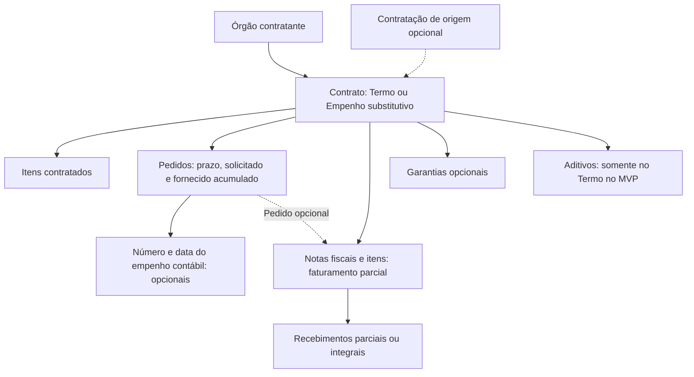

# Contratos e Fornecimento

## Modelo operacional vigente

A tela **Contratos** lista **Termos de Contrato** e **Empenhos substitutivos do Termo de Contrato**. Ambos são acompanhados como contratos independentes, com seus próprios itens, Pedidos, notas fiscais e recebimentos.

O agrupamento “Negócio comercial” foi retirado do cadastro, das consultas e da listagem. Não há seleção de negócio existente nem vínculo de um novo empenho a um Termo. Notas de empenho de acompanhamento contábil são referências dos **Pedidos**, não novos contratos.

### Relações operacionais



O diagrama representa a operação apresentada ao usuário. Não existe entidade Entrega: o fornecimento é registrado diretamente no Pedido.

## Cadastro do contrato

1. Escolha **Termo de Contrato** ou **Empenho substitutivo**.
2. Se houver contratação de origem, selecione-a para herdar o órgão e copiar os itens vencedores com preço informado, respeitando as quantidades disponíveis. Sem origem, selecione o órgão e cadastre os itens manualmente após salvar.
3. No Termo, informe a data de assinatura e a vigência. O campo genérico **Data do instrumento** foi removido. No Empenho substitutivo, a data de emissão identifica o próprio empenho e é usada para preencher os Pedidos.
4. **Link da publicação** é opcional, com ajuda para publicação no PNCP ou Diário Oficial da União, do Estado ou do Município.
5. **Link do diretório ou documento** é opcional e tem o mesmo nome em contratos, notas fiscais, garantias e aditivos. São links HTTP/HTTPS; não há upload nem armazenamento local.

### Conferência do valor

O **Valor do instrumento (R$)** continua informado conforme o documento e é confrontado com o total dos itens, tanto no Termo quanto no Empenho substitutivo.

```text
Total de cada item = quantidade × preço unitário, arredondado para centavos
Total dos itens = soma dos totais de cada item
Valor conferido = valor do instrumento igual ao total dos itens em centavos
```

Quantidades têm até três casas decimais; preços unitários, quatro; totais, duas. Usa-se aritmética decimal exata e arredondamento HALF_UP por linha, sem ponto flutuante nos cálculos financeiros.

Uma diferença de um centavo já gera alerta. O formulário mostra a conferência durante a edição; o backend recalcula a comparação nas consultas e na listagem. O alerta permanece em todas as abas enquanto existir divergência e é atualizado após alterações de itens ou aditivos.

A divergência **não bloqueia salvar um cadastro ainda incompleto**: itens manuais são incluídos após criar o contrato. Esse cadastro continua sinalizado como divergente até os valores coincidirem. Os limites financeiros de faturamento continuam sendo aplicados independentemente do alerta.

Com aditivos, a consulta compara os valores vigentes: valor original acrescido das variações do aditivo e itens acrescidos de suas variações de quantidade/preço. Os dados originais são preservados.

## Pedidos e início da execução

O Pedido registra referência opcional, data, prazo de fornecimento e observações. Os campos **Número do empenho** e **Data de emissão do empenho** são opcionais.

- Em Termos, esses campos podem registrar o empenho contábil correspondente ao Pedido.
- Em Empenhos substitutivos, o formulário já apresenta o número e a emissão do próprio empenho. O backend também preenche esses dados quando os campos chegam vazios. Os dados gravados no Pedido são independentes de alterações posteriores no contrato.
- Os dados do empenho também podem ser consultados e corrigidos no próprio Pedido.

Cadastrar um Pedido válido muda automaticamente um contrato **Em preparação** para **Em execução**, na mesma transação. Não é necessário mudar a situação manualmente antes de criar o Pedido. Se a gravação falhar, a situação não é alterada. Contratos encerrados ou cancelados não aceitam novos Pedidos.

A quantidade fornecida é acumulada. Pendente = solicitado − fornecido. Situações calculadas: Pendente, Parcialmente fornecido, Fornecido e Cancelado. Pedidos não podem consumir mais que o saldo contratual; correções não podem reduzir a quantidade abaixo do já fornecido ou faturado.

## Notas fiscais e recebimentos

A nota fiscal registra número, emissão, itens, valor calculado e pedido opcional. Não exige uma Entrega nem um Pedido artificial. O campo **Chave de Acesso** é opcional, aceita letras e números e permite guardar a referência para consulta externa no portal da fazenda competente. Não existe consulta automática nem validação fiscal da chave. O limite de armazenamento é de 100 caracteres; não se impõe uma chave exclusivamente numérica de 44 dígitos.

As notas permitem faturamento parcial. Quantidades não podem ultrapassar os saldos do contrato ou do Pedido vinculado. Cada nota preserva descrição, unidade, preço e total de suas linhas, mesmo após aditivos futuros.

Recebimentos são registrados na própria nota, com data e valor positivos. Não podem exceder seu saldo nem anteceder a emissão. Uma nota com recebimentos não pode ser cancelada. Encerrar o contrato não apaga obrigações nem impede registrar recebimentos válidos.

## Garantias, aditivos e histórico

Garantias são opcionais. Aditivos continuam disponíveis apenas no Termo, preservando valores originais, pedidos, notas e recebimentos anteriores. Reduções não podem invalidar saldos já utilizados. Itens manuais podem ser corrigidos antes da execução; após lançamentos, ajustes seguem as regras de aditivos já existentes.

Alterações relevantes mantêm auditoria antes/depois. Gravações contextuais verificam a versão e bloqueiam a base de execução no PostgreSQL para evitar conflitos e consumo concorrente do mesmo saldo. Mudanças posteriores na origem, no catálogo ou no fornecedor não atualizam automaticamente os snapshots dos itens contratados.

## Migração e compatibilidade

Nova migração: `20261122000100_simplify_contracts`, aplicada depois de `20261122000000_contracts_supply`.

A migração adiciona:

| Entidade       | Campos                                   |
| -------------- | ---------------------------------------- |
| `Contract`     | `substitutive`, `publicationUrl`         |
| `SupplyOrder`  | `commitmentNumber`, `commitmentIssuedAt` |
| `SalesInvoice` | `accessKey`                              |

Ela preserva documentos, IDs, itens, quantidades, notas, recebimentos e auditoria existentes. Não apaga colunas históricas de datas ou vínculos. O campo antigo de emissão deixa de ser exigido para o Termo; a assinatura continua obrigatória.

Empenhos anteriores vinculados a um Termo, explicitamente ou na mesma base de execução, são marcados como referências contábeis e deixam de aparecer como contratos. Seus números e datas são copiados para os Pedidos correspondentes, preservando os vínculos históricos das notas fiscais e recebimentos.

O armazenamento interno `ContractCase` permanece para compatibilidade e integridade, sem ser apresentado ao operador. Cada contrato novo cria sua própria base de execução; não é possível criar novos agrupamentos pela interface ou pelo backend.

**Exceção legada:** bases anteriores com vários instrumentos ainda independentes compartilhando os mesmos itens exigem revisão dos documentos para separar quantidades e obrigações. O sistema preserva e sinaliza esses registros e impede novos lançamentos ambíguos; recebimentos de notas já emitidas continuam disponíveis. Não divide quantidades, transfere recebimentos nem deduz vínculos jurídicos por suposição. Cadastros anteriores sem tipo definido são acessíveis por **Revisar cadastros legados** na listagem.

O documento [Negócio comercial](NEGOCIO_COMERCIAL.md) registra a concepção anterior e fica mantido como histórico, não como instrução operacional vigente.

## Implantação e verificação

Não há novas variáveis de ambiente. Em homologação, com as variáveis já documentadas configuradas:

```bash
npm ci
npm run db:generate
npm run db:migrate
npm run build
```

`db:migrate` executa `prisma migrate deploy`. Não usar `reset`, `db push` ou migrations de desenvolvimento em produção. Primeiro validar com documentos reais em homologação. A migração desta entrega é testada somente em PostgreSQL descartável, inclusive com registros anteriores e reaplicação sem pendências; não executa alterações no Neon por conta própria.

Rollback de aplicação preserva a expansão do banco. Não apagar novas tabelas/colunas ou desfazer dados com lançamentos; qualquer reversão de dados exige um plano específico com backup.

A entrega inclui testes de conciliação exata, campos opcionais, início automático de execução, contratos independentes, rejeição de agrupamentos, preenchimento do empenho, chave da NF, autorização e preservação dos dados legados, além dos testes de regressão existentes.

### Resultado das verificações desta entrega

- TypeScript, ESLint, Prettier e build Next.js aprovados.
- 154 testes unitários, 99 de integração com PostgreSQL e 15 de navegador: **268 aprovados**.
- Nova migração aplicada somente ao PostgreSQL descartável de testes; segunda execução sem pendências. A execução local utilizou o engine oficial WASM do Prisma com o adaptador PostgreSQL.
- Nenhuma migration no Neon e nenhum deploy de produção foram executados nesta entrega.
