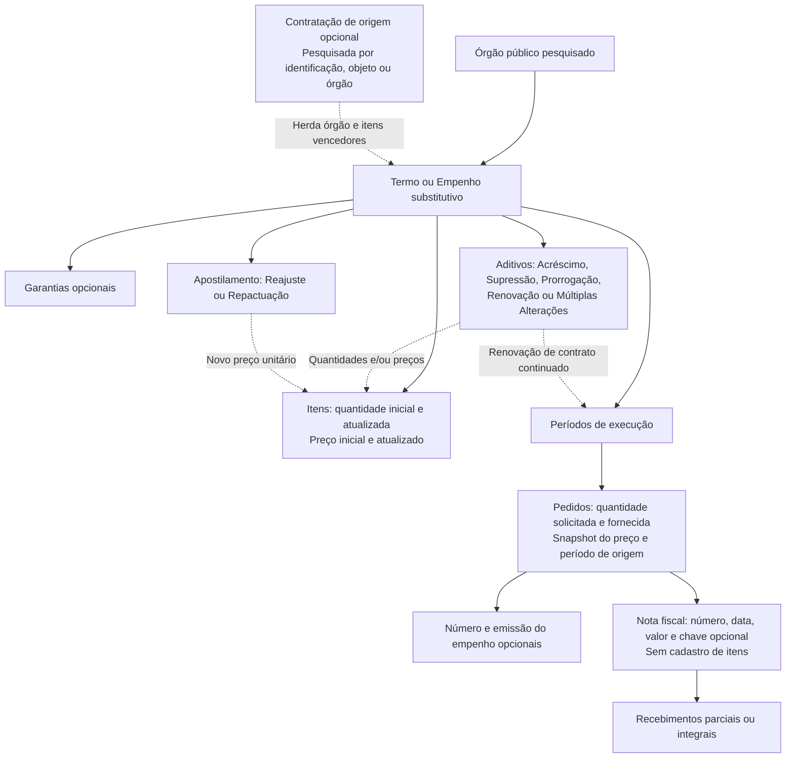

# Contratos e Fornecimento

## Fluxo operacional

A tela **Contratos** lista **Termos de Contrato** e **Empenhos substitutivos** independentes. Empenhos contábeis são referências opcionais dos **Pedidos**. O agrupamento Negócio comercial não faz parte da operação atual.



O diagrama é operacional. O armazenamento interno `ContractCase` permanece por compatibilidade; cada contrato novo tem sua própria base. Não existe entidade Entrega: o fornecimento é acompanhado diretamente no Pedido.

## Cadastro e pesquisa

- Escolha **Termo de Contrato** ou **Empenho substitutivo**.
- **Contratação de origem** e **Órgão público** são campos de pesquisa remota, com consultas paginadas de até 20 resultados e opção de carregar mais. A página não carrega as listas completas.
- A pesquisa de contratação aceita identificação, objeto ou órgão. A pesquisa de órgão aceita nome, sigla ou CNPJ.
- Selecionar a origem preenche o órgão automaticamente e carrega os itens vencedores com preço e quantidade disponível. Sem origem, selecione o órgão e cadastre os itens manualmente depois de salvar.
- O Termo usa data de assinatura e vigência; não há campo genérico Data do instrumento. O Empenho substitutivo usa sua data de emissão.
- **Continuado** identifica contratos cuja quantidade pode ser renovada para novos períodos. A renovação por aditivo continua disponível nos Termos, conforme o escopo anterior de aditivos do MVP.
- **Link da publicação** é opcional e tem ajuda para PNCP ou Diário Oficial da União, do Estado ou do Município.
- **Link do diretório ou documento** tem o mesmo nome nos formulários. São links HTTP/HTTPS; não há upload nem armazenamento local persistente.

As buscas e alterações exigem autenticação de administrador. Consultas não ficam em cache público; respostas antigas de pesquisa são canceladas quando a seleção muda.

## Valor original e valor atualizado

| Campo            | Significado                                                                                   | Como alterar                                                                                   |
| ---------------- | --------------------------------------------------------------------------------------------- | ---------------------------------------------------------------------------------------------- |
| Valor original   | Valor cadastrado como referência original do instrumento.                                     | Pela edição do contrato, inclusive após pedidos ou alterações contratuais, mantendo auditoria. |
| Valor atualizado | Valor vigente do período atual, resultante da base de execução e dos aditivos/apostilamentos. | Pelas alterações contratuais; não é um campo livre da edição.                                  |

No cadastro inicial, os dois valores começam iguais. A base inicial de execução é preservada separadamente para que uma correção posterior do valor original não recalcule valores já atualizados ou lançamentos financeiros.

`amount` armazena o valor original; `initialCurrentAmount` mantém a base de execução; `currentAmount` persiste o valor atualizado. A atualização deste último é calculada no backend e auditada, junto com os registros que a produziram.

O valor atualizado é comparado com a soma dos itens atualizados do período. Divergências em centavos geram alerta, sem impedir salvar um cadastro cujo preenchimento de itens ainda está em andamento. O formulário de edição também confere o valor original informado com seus itens de referência, sem transformar essa correção em alteração do valor atualizado.

### Precisão

- Quantidade: `Decimal(18,3)`.
- Preço unitário inicial, atualizado e novo preço de apostilamento: `Decimal(18,4)`.
- Valores de contrato, período, nota, garantia e recebimento: `Decimal(18,2)`.
- Cálculos exatos com inteiros de escala fixa. Total por linha = quantidade × preço, arredondado HALF_UP para centavos. Totais são somas das linhas arredondadas.
- Percentuais da interface usam até quatro casas. Eles são calculados por divisão exata com arredondamento HALF_UP, sem ponto flutuante financeiro.

## Períodos e contratos continuados

Cada contrato tem um período inicial. Pedidos e notas fiscais guardam o período a que pertencem; cada Pedido novo também guarda seu preço unitário no momento do cadastro.

**Quantidade atualizada** é a quantidade inicial acrescida ou reduzida pelos aditivos. **Quantidade disponível** é a atualizada menos a quantidade comprometida nos Pedidos daquele período.

### Prorrogação

Altera a data final da vigência e conserva o período, os preços e o saldo remanescente. Não renova quantitativos.

### Renovação

Exige contrato marcado como **Continuado** e nova data final posterior à vigente. Abre um novo período, iniciado no dia seguinte ao término anterior, usando a quantidade atualizada completa de cada item e mantendo seu preço atualizado.

```text
Quantidade inicial:                          100
Acréscimo por aditivo:                        10
Quantidade atualizada para cada período:    110
Pedidos do período anterior:                 90
Saldo não pedido ao encerrar:                20

Disponível ao abrir o novo período:         110
Não se transfere a sobra de 20.
```

O registro da Renovação efetiva a transição operacional para o novo período; não há agendamento automático de uma transição futura. O valor atualizado do novo período é a soma desse quantitativo completo pelos preços atualizados. Os valores e saldos dos períodos anteriores continuam no histórico. Por isso, a consulta separa **valor e saldo do período atual** de **faturamento, recebimentos e saldo a receber acumulados**.

Notas emitidas depois da renovação para um Pedido antigo permanecem no período do Pedido e não consomem o orçamento novo. Não é permitido criar Pedidos retroativos no período expirado nem aumentar quantidades de Pedidos daquele período. Correções de registros anteriores continuam sujeitas aos saldos já fornecidos e faturados.

Não é possível retirar a marca Continuado enquanto houver renovação ativa. A renovação mantém a quantidade atualizada e o preço; modificações adicionais devem ser registradas nos atos próprios.

## Aditivos

A guia Aditivos permanece exclusiva do Termo no MVP. Os novos registros utilizam as opções:

| Tipo                 | Regra                                                                                           |
| -------------------- | ----------------------------------------------------------------------------------------------- |
| Acréscimo            | Aumenta quantidade e/ou preço de item; não aceita reduções.                                     |
| Supressão            | Reduz quantidade e/ou preço de item; não aceita aumentos.                                       |
| Prorrogação          | Altera a vigência para uma data final posterior, sem alterar itens ou valor.                    |
| Renovação            | Abre novo período com quantitativo atualizado completo e preço mantido, em contrato continuado. |
| Múltiplas Alterações | Permite combinar as alterações pertinentes, respeitando os saldos e os limites de dados.        |

Para alterações de itens, se a variação monetária do cabeçalho ficar zero, o backend calcula a diferença do valor do período a partir dos itens. Uma variação monetária informada explicitamente é respeitada e continua sujeita à conferência com os itens e aos saldos financeiros.

Documentos novos não podem anteceder a última alteração ativa registrada. Datas e valores originais, Pedidos e notas anteriores não são reescritos. Registros antigos com tipo textual são preservados como legados; a migração não presume que um texto antigo representava uma renovação real.

## Apostilamento

A guia Apostilamento registra:

- Número, Data de Assinatura e Tipo (**Reajuste** ou **Repactuação**).
- Link do diretório ou documento e Observações opcionais.
- Novos preços unitários dos itens afetados.

O operador pode digitar o **novo valor** para calcular a variação percentual ou informar a **variação percentual** para calcular o novo valor. **Variação para todos (%)** e o botão Aplicar a todos preenchem os percentuais das linhas, que ainda podem ser ajustadas individualmente.

Somente o novo valor unitário de cada item alterado é persistido. Percentuais individuais e a variação para todos não são gravados. O backend valida os novos valores e recalcula o valor atualizado; não confia em um total simulado pelo navegador.

Se o preço anterior for zero e o novo for positivo, não existe percentual finito de variação: a interface orienta informar diretamente o novo preço. Variações que produzam preço negativo são recusadas, mesmo que o arredondamento pudesse ocultar um negativo muito pequeno.

Preços de Pedidos anteriores são preservados. Um Pedido posterior usa o preço atualizado resultante do apostilamento.

## Pedidos e notas fiscais

O Pedido mantém referência opcional, data, prazo, observações, número e emissão do empenho opcionais e suas quantidades solicitadas/fornecidas. No Empenho substitutivo, número e emissão são preenchidos automaticamente a partir do próprio instrumento, inclusive pelo backend quando chegam vazios.

Um Pedido válido muda automaticamente a situação **Em preparação → Em execução**, na mesma transação. Pedidos inválidos não alteram a situação. Contratos encerrados ou cancelados não recebem novos Pedidos.

A Nota Fiscal agora é um registro simples de um **Pedido obrigatório**, com número, data de emissão, valor, Chave de Acesso alfanumérica opcional, link e observações. Não há formulário nem tabela operacional de itens da nota. Várias notas parciais podem ser registradas para o mesmo Pedido, respeitando seus saldos financeiros e os do período.

A Chave de Acesso aceita até 100 caracteres alfanuméricos, sem exigir exclusivamente 44 dígitos. Não há emissão de NF-e, validação fiscal da chave ou consulta automática à fazenda pública.

Recebimentos continuam na própria nota, parciais ou integrais, sem ultrapassar o saldo e sem data anterior à emissão. Encerrar o contrato não apaga obrigações nem impede recebimentos válidos. Cancelar uma nota com recebimentos continua bloqueado; a exclusão definitiva é uma operação distinta e exige confirmação da perda também desses recebimentos.

## Garantias

São opcionais e usam as opções:

- Caução em dinheiro.
- Caução títulos da dívida pública.
- Seguro-garantia.
- Fiança bancária.
- Título de capitalização.

Textos antigos são mantidos no histórico. Ao editar um registro legado com tipo fora dessas opções, o operador precisa escolher uma opção da lista para salvar.

## Exclusões definitivas

Todas as exclusões exigem administrador, confirmação explícita de irreversibilidade e versão atual dos dados. A trilha de auditoria registra o antes/depois e permanece após a exclusão; não existe função de desfazer na interface.

| Registro excluído | Efeito confirmado no alerta                                                                                                                             |
| ----------------- | ------------------------------------------------------------------------------------------------------------------------------------------------------- |
| Contrato          | Apaga seus itens, períodos, Pedidos, notas, recebimentos, garantias, aditivos e apostilamentos. Não apaga órgão, catálogo ou contratação de origem.     |
| Pedido            | Apaga seus itens, notas vinculadas e respectivos recebimentos, liberando seu comprometimento de quantidade.                                             |
| Nota Fiscal       | Apaga a nota, seus recebimentos e eventuais linhas históricas legadas. Não apaga o Pedido.                                                              |
| Aditivo           | Remove o registro e recalcula seus efeitos. Deve respeitar alterações posteriores e quantidades/valores já utilizados.                                  |
| Apostilamento     | Remove o registro e recalcula os preços/valores vigentes, sem reescrever Pedidos anteriores. Deve respeitar alterações posteriores e saldos utilizados. |

Os alertas de Contrato, Pedido e Nota exibem as quantidades de dependentes que serão apagados. Aditivos/apostilamentos ativos com atos posteriores não podem ser excluídos antes desses atos: remova ou cancele a alteração mais recente primeiro. Renovação com Pedidos ou notas no novo período não pode ser excluída antes desses registros. Uma redução de saldo abaixo do já utilizado faz a transação inteira ser revertida.

Grupos legados com mais de um contrato independente ainda compartilhando itens exigem separação antes de exclusão do contrato; não se apagam outros contratos por suposição. Recebimentos de notas existentes permanecem disponíveis nesses legados.

## Migração, compatibilidade e implantação

Migração nova: `20261123000000_contract_periods_endorsements`.

Ela adiciona o campo Continuado, os valores de execução separados, os períodos de execução, o tipo estruturado dos aditivos, os preços históricos dos novos Pedidos e as entidades de Apostilamento e seus itens. Não remove registros ou colunas financeiras existentes.

Os contratos anteriores ganham o período inicial com seus valores e alterações existentes. Pedidos e notas são vinculados ao período 1, mantendo quantidades, valores, recebimentos, IDs e auditoria. Itens antigos de notas fiscais ficam armazenados somente como histórico de compatibilidade: novas notas não criam essas linhas e a operação não depende delas.

Pedidos anteriores que não tinham preço gravado continuam com snapshot desconhecido. Não se inventa um preço histórico: o limite de valor por Pedido é aplicado quando todos os preços estão disponíveis; o limite financeiro do período e os saldos de recebimento continuam obrigatórios. Cadastros legados sem valor ou tipo devem ser completados antes da execução.

Em homologação, com as variáveis já documentadas:

```bash
npm ci
npm run db:generate
npm run db:migrate
npm run build
```

Não há novas variáveis. `db:migrate` executa `prisma migrate deploy`. Não executar `reset`, `db push` ou migrations de desenvolvimento em produção. Aplicar primeiro em homologação com backup e documentos reais. Não remover a expansão de banco ao reverter um deploy, especialmente depois de haver períodos, apostilamentos ou lançamentos financeiros novos.

A migração e os fluxos são testados somente em PostgreSQL descartável neste ambiente. Não há migration automática no Neon nem publicação de produção nesta implementação.

### Verificações desta entrega

- TypeScript, ESLint, Prettier e build Next.js aprovados.
- **280 testes aprovados:** 161 unitários, 102 de integração com PostgreSQL e 17 de navegador.
- A migração foi aplicada somente ao PostgreSQL descartável local e a segunda execução não encontrou pendências. Foi usado o engine oficial WASM do Prisma com o adaptador PostgreSQL neste ambiente.
- Os testes verificam o exemplo de renovação 100 + 10 com sobra de 20, separação de períodos, preços históricos, exclusões e dependências, pesquisa privada/paginada, apostilamento bidirecional e preservação dos campos após erros de validação.
