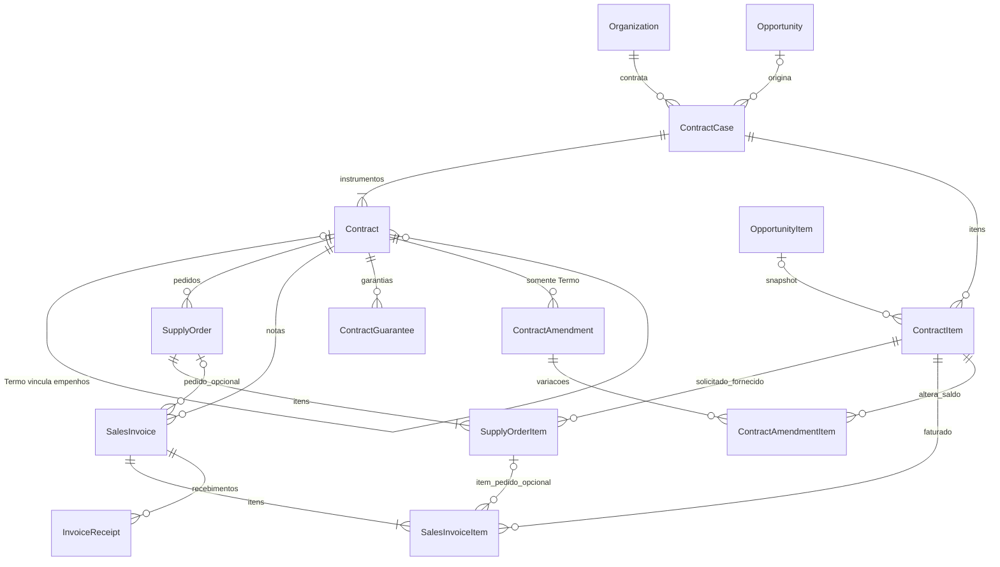

# Contratos e Fornecimento

Implementação baseada no anexo “Govnex — Revisão do módulo de Contratos e Fornecimento”. As novas orientações prevalecem sobre as referências antigas a Entrega nos Documentos 03, 07 e 10. O Documento 04 não estava disponível. Não existe entidade, evento ou comprovante individual de Entrega nesta implementação.

## Uso

1. Acesse **Contratos → Novo contrato** e escolha obrigatoriamente **Termo de Contrato** ou **Nota de Empenho**.
2. Para um negócio novo, selecione a contratação de origem ou informe manualmente o órgão. Com origem, o órgão é herdado e os itens vencedores com oferta preenchida podem ser copiados, inclusive em quantidades parciais. Sem origem, cadastre os itens em Dados gerais após salvar.
3. Para instrumentos da mesma operação, selecione **Negócio comercial existente**. Se houver Termo, pode vinculá-lo no mesmo cadastro. Um Termo recebido posteriormente também pode ser incluído no negócio que já contém empenhos. Esse empenho usa os mesmos itens, reservas e saldos; não crie outro negócio comercial.
4. O texto opcional “Referência de empenho” do Termo é apenas uma referência. Nunca cria outro instrumento automaticamente.
5. Complete o instrumento e defina **Em andamento** para novos pedidos, notas fiscais ou aditivos. Encerramento/cancelamento gerencial não apaga obrigações registradas; recebimentos continuam possíveis para notas válidas.
6. Registre cada pedido na aba Pedidos. Informe o fornecimento **acumulado**, incluindo fornecimentos parciais. Pendente = solicitado − fornecido. A situação é calculada. É possível corrigir a referência, as datas, o prazo e as quantidades, respeitando o que já foi fornecido/faturado.
7. Registre notas fiscais em Notas Fiscais, com ou sem pedido. Deixe em branco os itens que não entram na operação. A nota registra quantidade, descrição, unidade, preço vigente e total de cada linha. Recebimentos parciais são registrados na própria nota.
8. Garantias são opcionais, por instrumento. Aditivos aparecem somente no Termo e registram variações com sinal e/ou nova data final. Para reduzir, use valores negativos. Aditivos não alteram os valores originais nem reescrevem pedidos ou notas anteriores.

Os links de documentos são opcionais; não há upload nem armazenamento local. Dados de fonte, órgão e itens são preservados em snapshots para consulta/auditoria. Mudanças posteriores no catálogo, fornecedor ou proposta não atualizam automaticamente os itens contratados.

## Modelo

`ContractCase` é a referência gerencial de um negócio; `Contract` é um instrumento jurídico desse negócio. Cada negócio admite no máximo um Termo e vários empenhos, inclusive somente empenhos. Os instrumentos relacionados não duplicam os itens.



## Cálculos e integridade

- Quantidades: `Decimal(18,3)`; preços unitários: `Decimal(18,4)`; totais/recebimentos/garantias: `Decimal(18,2)`.
- Aritmética exata com inteiros de escala fixa. Total da linha = quantidade × preço, arredondado HALF_UP para centavos; total da nota = soma das linhas já arredondadas.
- Quantidade vigente e preço vigente = original + variações dos aditivos não cancelados. O preço vigente afeta notas futuras; uma nota existente mantém seu snapshot.
- Valor vigente do negócio com Termo = valor original do Termo + aditivos não cancelados. Valores de seus empenhos não são somados novamente. Sem Termo, a base é a soma dos valores dos empenhos do mesmo negócio. Situação gerencial não elimina valores originais nem obrigações: notas canceladas deixam de compor o faturamento, mas seus documentos permanecem no histórico.
- Solicitações não podem ultrapassar a quantidade vigente. O cancelamento de um pedido libera apenas o saldo não consumido; continua reservado o maior entre quantidade fornecida e quantidade faturada vinculada a ele.
- Faturamento válido não pode ultrapassar quantidade vigente, quantidade do pedido quando vinculado, valor vigente do negócio ou valor do empenho faturado. Pedido não é obrigatório e a nota não exige fornecimento prévio registrado.
- Recebimentos positivos e parciais não podem ultrapassar o saldo da nota e não podem anteceder sua emissão. Nota com recebimento não pode ser cancelada.
- Aditivos não podem produzir preço/quantidade negativos, exceder a capacidade dos campos nem reduzir valores ou quantidades abaixo do já comprometido. A quantidade original alocada entre negócios respeita a proposta de origem; acréscimos jurídicos posteriores por aditivo são registrados separadamente.
- Itens manuais podem ser incluídos, editados e excluídos antes da execução; depois, alterações de valor/quantidade usam aditivos no Termo. Itens copiados da origem preservam o retrato da proposta vencedora.
- Toda mutação contextual bloqueia o negócio no PostgreSQL, verifica a versão e grava auditoria com antes/depois na mesma transação. Instrumentos de um mesmo negócio compartilham a versão, evitando gravações sobre dados desatualizados.
- Chaves compostas impedem vínculos de itens/pedidos/notas entre negócios diferentes. Exclusão da contratação e remoção do papel de órgão público são bloqueadas quando há contratos vinculados.
- Situações gerenciais: Em preparação, Em andamento, Encerrado e Cancelado. Elas não são procedimentos administrativos do órgão público.

## Migração e implantação

Migração: `20261122000000_contracts_supply`.

Ela adiciona as tabelas de execução e amplia `Contract`; não exclui contratos nem notas/recebimentos. Na base anterior havia somente o vínculo mínimo `Contract` (origem + referência), sem execução financeira ou Entregas a converter.

Cada contrato antigo ganha uma referência gerencial própria, herdando órgão/origem e preservando seu ID, número e timestamps. O tipo, datas e valor jurídico ficam **não informados**, pois não podem ser deduzidos com segurança. Nenhuma migração presume que dois documentos antigos são o mesmo negócio. Revise esses cadastros em Dados gerais. Para contratos de origem ainda sem itens, o botão de cópia explícita importa a proposta vencedora **atualmente disponível**, inclusive se a origem estiver arquivada; ele não reconstrói uma proposta histórica desconhecida.

A antiga unicidade origem+número foi substituída por órgão+tipo+número, permitindo um Termo e um empenho com o mesmo número, mas impedindo instrumentos duplicados do mesmo tipo/órgão. Um índice parcial limita um Termo por negócio. IDs e relacionamentos antigos são mantidos.

Aplicar em homologação primeiro, com backup e variáveis de banco do ambiente pretendido:

```bash
npm ci
npm run db:generate
npm run db:migrate
npm run build
```

`db:migrate` usa `prisma migrate deploy`; nunca execute `db:dev`, `reset` ou `db push` em produção. Não há novas variáveis além das já documentadas em `.env.example`. O deploy Vercel deve usar o framework Next.js e a mesma base da migration, mantendo os segredos no ambiente.

Rollback de aplicação: retornar ao deploy anterior sem apagar a expansão de schema. Não remover tabelas de execução depois de haver lançamentos. Reversão de dados exige plano específico com backup; não há migration destrutiva de rollback.

## Validação e limites

Verificações concluídas: TypeScript, ESLint, Prettier e build Next.js aprovados; 151 testes unitários, 91 de integração com PostgreSQL e 15 de navegador (257 no total), todos aprovados.

Testes cobrem instrumentos, não duplicação comercial, snapshots, pedidos parciais, cancelamentos, faturamento, recebimentos, garantias, aditivos, concorrência, autorização e preservação de registros antigos. Fluxos de navegador verificam cadastro de Termo e empenho relacionado e execução contextual.

Neste ambiente, a execução das migrations utilizou o engine oficial WASM do Prisma com adaptador PostgreSQL. O procedimento normal de implantação continua sendo `npm run db:migrate`.

A migration foi aplicada somente ao PostgreSQL descartável de testes, com segunda execução sem migrações pendentes. Neon/produção e publicação Vercel não foram alterados nesta entrega.

A validação fiscal de uma NF, arquivos XML, emissão de NF-e, estornos financeiros, gestão de documentos, gestão orçamentária pública e fluxos administrativos de aceite não fazem parte do escopo. A nota é um registro interno manual; o recebimento registra dinheiro efetivamente recebido. Valide em homologação com documentos reais antes do uso operacional.
