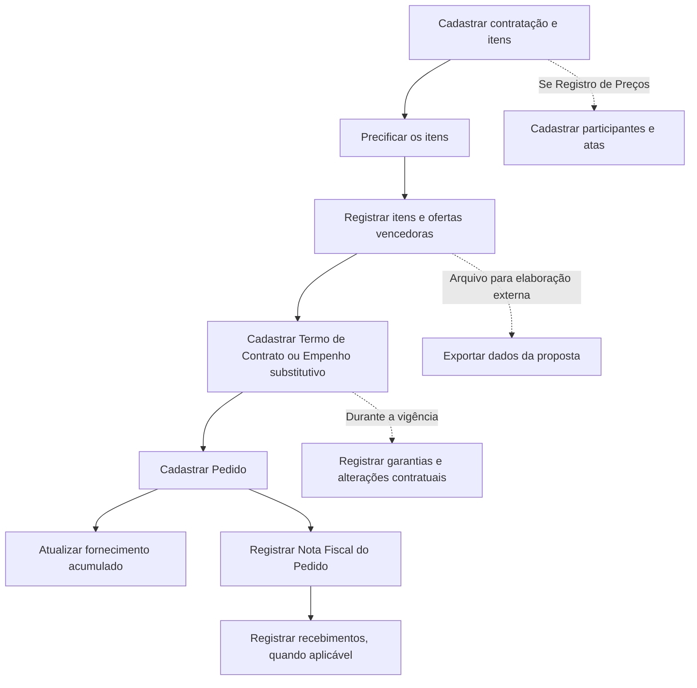

# Manual de uso — Govnex ERP

Edição de 25/11/2026. Orientações para os módulos de **Contratações** e **Contratos**, conforme as funcionalidades implementadas nesta versão do MVP.

## Por onde começar

Este manual explica as tarefas do usuário. As instruções técnicas de instalação e implantação continuam no [README](../README.md) e na [documentação de implantação](DEPLOY.md).

1. Acesse o endereço do sistema informado pela Govnex e entre com seu e-mail e senha individuais.
2. Use o menu lateral para abrir **Contratações** ou **Contratos**.
3. Antes de cadastrar uma contratação, confira o órgão em **Órgãos públicos**. Para precificar, mantenha os fornecedores e seus produtos em **Catálogo** atualizados.
4. Confira os dados da empresa antes de exportar informações para uma proposta comercial.

Os usuários do MVP são administradores. Utilize sua própria conta para que o histórico identifique corretamente quem realizou as alterações.

## Capítulos

- [Contratações: cadastro, itens, precificação, proposta vencedora, atas, participantes e arquivos](manual/contratacoes.md).
- [Contratos: instrumentos, pedidos, fornecimento, notas fiscais, garantias, aditivos e apostilamentos](manual/contratos.md).

## Fluxo de trabalho

O contrato pode ser cadastrado sem contratação de origem, com inclusão manual de seus itens. No MVP, a ata não controla automaticamente o consumo por contratos ou pedidos.

## Qual tela usar?

| Preciso…                                                  | Onde fazer                                                               |
| --------------------------------------------------------- | ------------------------------------------------------------------------ |
| Acompanhar uma licitação ou processo de compra            | **Contratações**                                                         |
| Registrar os produtos ou serviços disputados              | Contratação → **Gerenciar itens**                                        |
| Calcular o preço mínimo viável                            | Contratação → **Precificação**                                           |
| Registrar o preço com que vencemos um item                | Contratação → **Proposta Vencedora**                                     |
| Registrar uma ata ou um órgão participante de SRP         | Contratação → **Registros de preços** ou **Participantes**               |
| Registrar o instrumento assinado ou empenho substitutivo  | **Contratos**                                                            |
| Registrar a solicitação de fornecimento e suas entregas   | Contrato → **Pedidos**                                                   |
| Registrar a nota de um pedido e seu recebimento           | Contrato → **Notas Fiscais**                                             |
| Alterar quantitativo, preço ou vigência por termo aditivo | Contrato → **Aditivos**, nos Termos de Contrato                          |
| Registrar reajuste ou repactuação                         | Contrato → **Apostilamento**                                             |
| Consultar datas, atividades e avisos                      | **Agenda operacional** → **Calendário**, **Tarefas** ou **Notificações** |

## Termos usados no sistema

| Termo               | Significado operacional                                                                                                                   |
| ------------------- | ----------------------------------------------------------------------------------------------------------------------------------------- |
| Contratação         | Processo comercial/licitação acompanhado desde a análise e formação de preço. Não é o instrumento contratual.                             |
| Contrato            | Instrumento formal: **Termo de Contrato** ou **Empenho substitutivo**.                                                                    |
| Empenho no Pedido   | Referência contábil opcional. Não cria outro contrato na lista.                                                                           |
| Item do catálogo    | Cadastro reutilizável de material ou serviço, com seus fornecedores.                                                                      |
| Item da contratação | Especificação e quantidade daquela disputa, com estimativa, precificação e eventual oferta vencedora.                                     |
| Item do contrato    | Quantidade e preço contratados, acompanhados durante a execução.                                                                          |
| Valor unitário      | Preço de uma unidade; não é o total da linha.                                                                                             |
| Total do item       | Quantidade multiplicada pelo preço unitário, arredondada para centavos.                                                                   |
| Disponível          | Saldo quantitativo apresentado no contexto da tela. Na ata, ainda não há consumo automático; no contrato, há comprometimento por Pedidos. |

## Convenções e cuidados

- Nas telas, os valores são apresentados em reais e as datas no padrão brasileiro. Prazos com horário usam Brasília. Nos arquivos JSON, os decimais seguem outro formato: veja o capítulo de Contratações.
- Campos com asterisco são obrigatórios. Use o ícone de ajuda ao lado do campo quando disponível.
- **Salvar** confirma as alterações daquele formulário ou linha. Alterações não salvas podem ser perdidas ao sair, cancelar ou fechar um modal.
- Aguarde a mensagem de sucesso. Se houver erro, corrija o campo indicado; não presuma que os dados foram registrados.
- Se o sistema informar que o registro foi alterado por outra pessoa, recarregue a página e confira os dados atuais antes de repetir a operação.
- **Cancelar** um formulário descarta sua edição. **Cancelar** um Pedido, nota ou aditivo é uma ação sobre o registro e tem consequências próprias, descritas no capítulo de Contratos.
- **Arquivar** uma contratação preserva os dados e permite restauração. **Excluir** é definitivo e pode apagar registros vinculados; leia a confirmação antes de prosseguir.
- Links de documentos apontam para um arquivo ou diretório externo. O cadastro do link não envia o documento para o Govnex; confira também as permissões de acesso na plataforma de origem.

## Prazos e notificações

O **sino na barra superior** é o atalho para os avisos. O menu **Agenda operacional** mantém três telas separadas: **Calendário** para datas, **Tarefas** para atividades e **Notificações** para avisos.

| Prazo                                     | Antecedências previstas na central                                 |
| ----------------------------------------- | ------------------------------------------------------------------ |
| Sessão pública / apresentação da proposta | 1 dia, 1 hora, 15 minutos e início                                 |
| Entrega de Pedido pendente                | 7, 3 e 1 dia; no vencimento e, enquanto pendente, avisos de atraso |
| Fim da vigência do contrato               | 90, 30 e 7 dias; no encerramento                                   |
| Validade da ata                           | 30 e 7 dias; no vencimento                                         |
| Garantia                                  | 30, 7 e 1 dia; no vencimento                                       |
| Tarefa com prazo                          | 7 e 1 dia; no vencimento e avisos de atraso enquanto pendente      |

Prazos sem horário são tratados às 8h de Brasília. A geração automática depende do agendamento configurado pelo responsável técnico. Ler um aviso não conclui a tarefa, não registra entrega e não altera a situação do contrato.

No MVP, funcionam os avisos no próprio sistema e os alertas internos de sessão. **Não há envio de notificações por e-mail ou WhatsApp.** A existência do contato ou telefone cadastrado não ativa esses canais.

## Limites desta edição

Este manual cobre as operações implementadas; não pressupõe gestão de cotações, emissão fiscal, elaboração automática de PDF, integração direta com agente de IA ou gestão financeira ampliada. O registro simples de notas e recebimentos e o resumo comercial já existentes são explicados por fazerem parte do fluxo atual.

As orientações foram consolidadas a partir da documentação de implementação e conferidas com o código das telas e regras atuais. Documentos históricos podem usar nomes ou fluxos anteriores; para a operação destes módulos, siga os capítulos deste manual.
