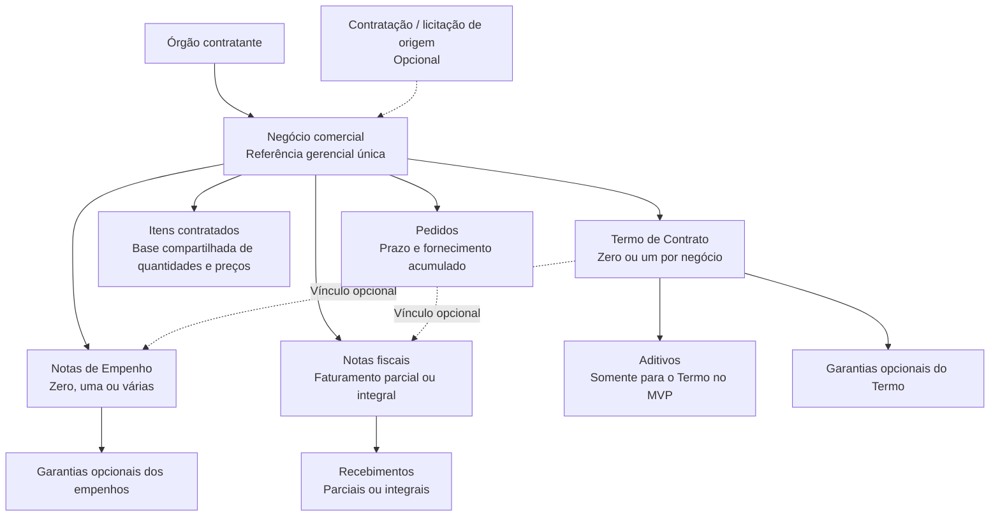
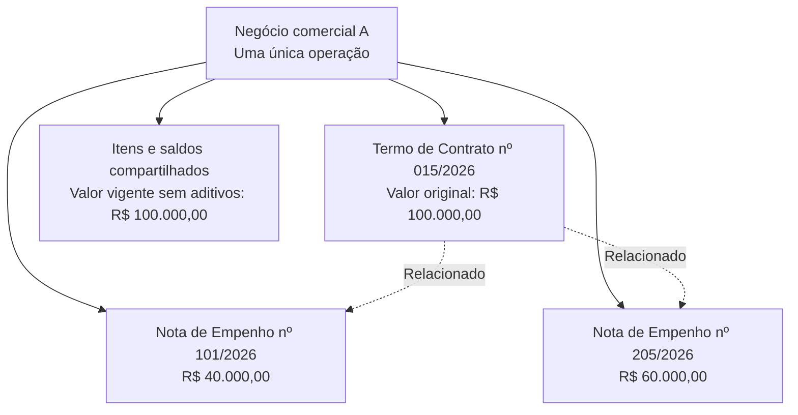
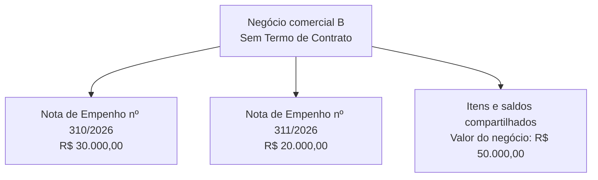

# Govnex — Negócio comercial, Termo de Contrato e Notas de Empenho

> **Documento histórico — concepção substituída.** Por decisão posterior, o agrupamento Negócio comercial foi retirado do fluxo do sistema. Contratos agora representam Termos ou Empenhos substitutivos independentes; empenhos contábeis são acompanhados nos Pedidos. Consulte [Contratos e Fornecimento](CONTRATOS.md) para as regras vigentes.

## 1. O que é um negócio comercial

No Govnex, **Negócio comercial é o agrupamento interno de uma mesma operação de venda**. Ele reúne o órgão contratante, a contratação de origem quando existente, os instrumentos relacionados, os itens e o acompanhamento da execução.

Esse agrupamento permite acompanhar uma operação que tenha um Termo de Contrato e vários empenhos, ou somente Notas de Empenho, mantendo uma única referência gerencial e os mesmos saldos.

O negócio comercial não é um documento jurídico, uma classificação contábil ou um procedimento do órgão público. É a forma como a Govnex organiza a operação dentro do ERP.

| Elemento          | Função no Govnex                                                              |
| ----------------- | ----------------------------------------------------------------------------- |
| Negócio comercial | Agrupar a operação de venda e consolidar seus itens, valores e saldos.        |
| Termo de Contrato | Registrar o instrumento contratual, sua assinatura, vigência e valor.         |
| Nota de Empenho   | Registrar o instrumento recebido e, quando houver, seu vínculo com o Termo.   |
| Pedido            | Controlar o que foi solicitado, seu prazo e a quantidade fornecida acumulada. |
| Nota fiscal       | Registrar os itens e valores faturados, com pedido opcional.                  |
| Recebimento       | Registrar o valor efetivamente recebido referente a uma nota fiscal.          |

## 2. Por que separar o negócio dos instrumentos

Uma única venda pode ser representada por mais de um documento. Cadastrar cada documento como uma venda independente poderia duplicar o valor contratado, os itens e os saldos.

Por exemplo, um contrato de **R$ 100.000,00** pode ter dois empenhos relacionados, de **R$ 40.000,00** e **R$ 60.000,00**. Esses documentos representam a mesma operação. O valor comercial é **R$ 100.000,00**, sem somar novamente os empenhos ao valor do Termo.

O Govnex preserva cada instrumento individualmente, mas compartilha a base de acompanhamento do negócio.

## 3. Diagrama geral da estrutura



**Leitura do diagrama:** cada negócio possui pelo menos um instrumento. Pode ter um Termo, apenas empenhos, ou um Termo acompanhado de empenhos. Pedidos e notas fiscais identificam o instrumento utilizado e permanecem dentro do mesmo negócio. As linhas pontilhadas indicam vínculos opcionais.

O fornecimento é acompanhado diretamente no Pedido. Não existe uma entidade Entrega intermediária entre pedido e faturamento.

## 4. Situação A — Termo de Contrato acompanhado de empenhos

Nesta situação, o Termo é cadastrado como instrumento contratual, e os empenhos relacionados são incluídos no **mesmo negócio comercial**.



O cálculo do valor vigente é:

```text
Valor vigente do negócio = valor original do Termo + variações dos aditivos não cancelados
```

Os valores dos empenhos relacionados não são acrescentados novamente a esse total. Entretanto, o valor de cada empenho também limita o faturamento registrado naquele instrumento.

O campo textual **Referência de empenho**, disponível no Termo, serve apenas para anotação. Preenchê-lo não cria automaticamente outro instrumento. Para acompanhar vários empenhos individualmente, eles devem ser cadastrados e vinculados ao mesmo negócio.

## 5. Situação B — Nota de Empenho como instrumento substitutivo

Quando a contratação puder ser formalizada por Nota de Empenho em substituição ao Termo, o Govnex permite cadastrar a operação sem criar um Termo artificial.



Nesse exemplo, os dois empenhos representam parcelas distintas da mesma operação. O valor do negócio é a soma dos valores dos empenhos cadastrados, sem repetir o mesmo documento ou a mesma obrigação.

```text
Valor do negócio sem Termo = soma dos valores das Notas de Empenho desse negócio
```

Um negócio também pode conter apenas uma Nota de Empenho. Não é necessário criar um Pedido somente para representar o empenho: o Pedido deve ser registrado quando houver uma solicitação de fornecimento a acompanhar.

**A ausência de vínculo com um Termo não comprova, por si só, que o empenho é juridicamente substitutivo.** Ela também pode indicar que o Termo ainda não foi cadastrado. A função do documento deve ser conferida na documentação da contratação.

## 6. A diferença em relação ao caráter contábil do empenho

A distinção discutida aqui é o **papel do documento na contratação**:

- Quando há Termo, a Nota de Empenho pode ser acompanhada como documento relacionado à execução daquele contrato.
- Quando couber a substituição do Termo pela Nota de Empenho, ela pode ser o instrumento utilizado para registrar a contratação no Govnex.

Isso não divide os empenhos entre uma categoria exclusivamente contábil e outra sem natureza orçamentária. A estrutura do ERP organiza os vínculos comerciais e documentais; não realiza classificação contábil do empenho nem determina automaticamente a possibilidade jurídica de substituição do Termo.

**Na implementação atual, não há um campo específico “empenho contábil” ou “empenho substitutivo”.** O sistema registra o tipo Nota de Empenho e permite vinculá-la a um Termo do mesmo negócio, quando existente.

## 7. Quando utilizar o mesmo negócio

| Situação                                                          | Como cadastrar                                                                                                  |
| ----------------------------------------------------------------- | --------------------------------------------------------------------------------------------------------------- |
| Novo Termo referente a uma nova operação                          | Criar um negócio comercial e cadastrar o Termo.                                                                 |
| Empenho relacionado a um Termo já cadastrado                      | Selecionar o negócio existente e vincular o empenho ao Termo.                                                   |
| Novo empenho da mesma operação já acompanhada por outros empenhos | Selecionar o negócio existente e cadastrar o novo instrumento.                                                  |
| Empenho que representa uma operação independente, sem Termo       | Criar um novo negócio comercial com a Nota de Empenho.                                                          |
| Termo recebido após o cadastro dos empenhos da mesma operação     | Incluir o Termo no negócio existente, preservando os itens e a execução registrada.                             |
| Outra venda para o mesmo órgão                                    | Criar outro negócio se as obrigações forem independentes. O órgão em comum não basta para agrupar as operações. |

A origem na mesma licitação também não obriga que todas as operações sejam agrupadas. O critério é pertencerem à mesma contratação comercial e às mesmas obrigações acompanhadas.

## 8. O que é compartilhado e o que permanece individual

**O negócio compartilha:** órgão, origem quando houver, itens contratados, saldos de quantidade e consolidação de faturamento e recebimentos.

**Cada instrumento mantém:** tipo, número, datas, valor, situação gerencial, observações, documento e garantias. O Termo também mantém assinatura, vigência e aditivos. A Nota de Empenho pode registrar prazo de fornecimento e referência ao Termo.

Pedidos e notas fiscais guardam seu vínculo com o instrumento, mas são consolidados no mesmo negócio. Uma nota fiscal pode ter recebimentos parciais. Registrar ou consultar esses dados por instrumentos diferentes não cria novos lançamentos financeiros.

O faturamento deve respeitar os saldos dos itens, o saldo do pedido quando vinculado, o valor vigente do negócio e o valor do empenho utilizado. Aditivos preservam os valores originais e não reescrevem notas fiscais ou recebimentos anteriores.

A situação gerencial de um instrumento não elimina seus valores originais nem apaga obrigações registradas. Uma nota fiscal cancelada deixa de compor o faturamento válido, mantendo seu histórico.

## 9. Correspondência com o modelo técnico

| Conceito apresentado ao operador     | Entidade interna                              |
| ------------------------------------ | --------------------------------------------- |
| Negócio comercial                    | `ContractCase`                                |
| Termo de Contrato ou Nota de Empenho | `Contract`                                    |
| Item contratado compartilhado        | `ContractItem`                                |
| Pedido e seus itens                  | `SupplyOrder` e `SupplyOrderItem`             |
| Nota fiscal e seus itens             | `SalesInvoice` e `SalesInvoiceItem`           |
| Recebimento                          | `InvoiceReceipt`                              |
| Garantia                             | `ContractGuarantee`                           |
| Aditivo e alterações de itens        | `ContractAmendment` e `ContractAmendmentItem` |

A referência do negócio é gerada automaticamente. Os números de contratos e empenhos continuam sendo informados conforme os documentos recebidos.

Para detalhes de integridade, migração e operação do módulo, consulte [Contratos e Fornecimento](CONTRATOS.md).

Os exemplos de números e valores deste documento são ilustrativos e não representam registros reais da Govnex.
